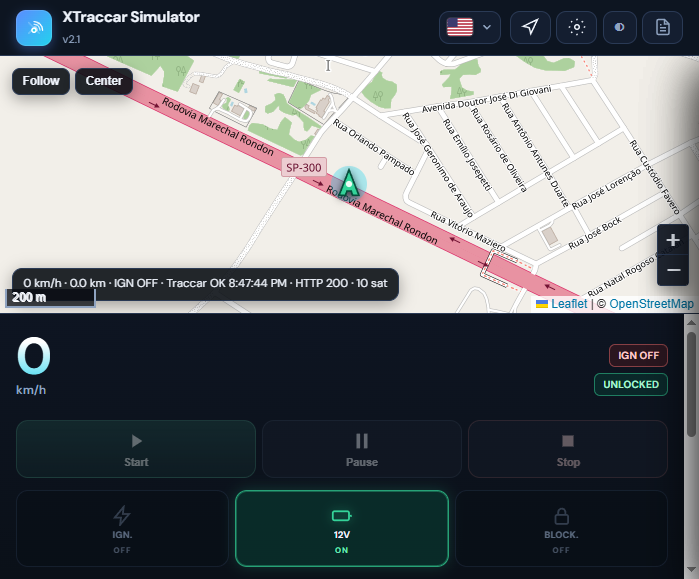

# XTraccar Simulator

[English](README.md) · **Español** · [Português](README.pt.md)

[](https://ko-fi.com/G7B227FYIH)

Simulador de vehículo para pruebas y demostraciones en [Traccar](https://www.traccar.org/) mediante el protocolo HTTP **OsmAnd** (puerto **5055**). El vehículo sigue **calles reales** (OpenStreetMap + **OSRM**) o un archivo **GPX**, con dinámica de velocidad, telemetría realista y panel web en vivo.

> Disponible para quien necesite probar integraciones Traccar/OsmAnd. No es un proyecto open source con licencia pública de contribución.

**Idiomas del panel:** **inglés**, **español** y **portugués** (menú de banderas en la barra superior).



---

## Índice

1. [Poner todo en marcha](#poner-todo-en-marcha)
2. [Parar y reiniciar](#parar-y-reiniciar)
3. [Funciones](#funciones)
4. [Configuración](#configuración-configyaml--panel)
5. [Uso del panel](#uso-del-panel)
6. [Telemetría](#telemetría)
7. [API REST](#api-rest)
8. [Solución de problemas](#solución-de-problemas)
9. [Estructura del proyecto](#estructura-del-proyecto)
10. [Distribución](#distribución)

---

## Poner todo en marcha

Necesita **dos servicios**: **Traccar** (recibe posiciones) y este **simulador** (panel + envíos OsmAnd).

### 1. Traccar

1. Instale e inicie Traccar ([traccar.org](https://www.traccar.org/)).
2. Confirme que **OsmAnd** escucha en el puerto **5055**.
3. Cree un **dispositivo** y anote su **identificador único**.
4. Use el mismo valor en `device_id` del simulador (`config.yaml`).
5. Abra el firewall **TCP 5055** entre el PC del simulador y Traccar.

**URL OsmAnd típica:** `http://IP_TRACCAR:5055/`

### 2. Primera instalación (Windows)

```powershell
cd "C:\Users\...\XTraccar Simulator"
python -m venv .venv
.venv\Scripts\activate
pip install -e .
copy config.example.yaml config.yaml
notepad config.yaml
```

Edite al menos `traccar_url` y `device_id`. **`config.yaml` está en `.gitignore`**.

**Valores por defecto** (`config.example.yaml`):

| Campo | Valor |
|-------|--------|
| `default_lat` / `default_lon` | **-22.7487**, **-48.5837** |
| `cell_mcc` / `mnc` / `lac` / `cid` | **724** / **5** / **43714** / **45086** |
| Intervalos envío (ign ON / OFF) | **5 s** / **60 s** |
| Panel | **http://127.0.0.1:8081** |

### 3. Iniciar el simulador

- **Windows:** doble clic en **`iniciar.bat`** (libera puerto **8081**).
- **Manual:** `.venv\Scripts\uvicorn.exe app.main:app --host 127.0.0.1 --port 8081`

Panel **8081** · Traccar OsmAnd **5055**.

### 4. Comprobar

- http://127.0.0.1:8081  
- http://127.0.0.1:8081/api/health → `"version": "2.1"`

### 5. Primera prueba con Traccar

1. Panel → **Ajustes** → URL + Device ID → **Guardar** → **Probar conexión**.
2. Verifique **Última comunicación** en Traccar.

### 6. Linux / macOS

```bash
cd "XTraccar Simulator"
python3 -m venv .venv && source .venv/bin/activate
pip install -e .
cp config.example.yaml config.yaml
uvicorn app.main:app --host 127.0.0.1 --port 8081
```

---

## Parar y reiniciar

| Acción | Cómo |
|--------|------|
| Parar simulador | **Ctrl+C** en la ventana de uvicorn |
| Reiniciar (Windows) | Ejecutar **`iniciar.bat`** otra vez |
| Puerto 8081 ocupado | `iniciar.bat` o cerrar el proceso |
| Tras cambios | Reiniciar uvicorn; **Ctrl+F5** en el navegador |

Inicie **Traccar primero**, luego el simulador.

---

## Funciones

| Área | Capacidades |
|------|-------------|
| **Mapa** | Leaflet, OSM/HOT, waypoints, OSRM, GPX, Seguir (zoom mín. 16), HUD |
| **Viaje** | Iniciar, pausar/reanudar (**Espacio**), parar |
| **Traccar** | Heartbeat, intervalos ign ON/OFF, prueba HTTP, registro |
| **Vehículo** | Encendido, 12V, bloqueo, odómetro |
| **Telemetría** | RPM, combustible, celda, Wi‑Fi, alarmas, entradas digitales |
| **GPX** | Exportar traza; replay punto a punto |
| **UI** | EN/ES/PT, tema claro/oscuro |
| **Automatización** | REST + WebSocket `/ws/live` |

---

## Configuración (`config.yaml` / panel)

Se carga **`config.yaml`** al iniciar (si no existe, defaults del código).

| Clave | Descripción |
|-------|-------------|
| `traccar_url` | URL base OsmAnd |
| `device_id` | Unique id en Traccar |
| `interval_ignition_on` / `off` | Intervalo de envío (s) |
| `osrm_base_url` | API OSRM |
| `traffic_profile` | `low` \| `normal` \| `heavy` |
| `default_lat` / `default_lon` | Centro del mapa |
| `odometer_base_km` | Odómetro inicial (km) |
| `cell_*` | Torre simulada |
| `driver_unique_id` | Conductor OsmAnd (opcional) |
| `map_style` | `osm` o `hot` |

Variables de entorno: prefijo **`TRACCAR_SIM_`**.

---

## Uso del panel

1. **Ajustes** → URL Traccar + Device ID → **Guardar** → **Probar conexión**.
2. **Ruta** → clics en el mapa (2+ puntos) → **Calcular ruta (OSRM)** o **GPX**.
3. Odómetro opcional → **OK**.
4. **Iniciar** — observe Traccar y el HUD.

---

## Telemetría

- **Odómetro:** parámetro **`odometer`** en **metros**.
- **RPM:** 0 apagado; ralentí parado; sube con la velocidad en movimiento.
- **Celda por defecto:** `724,5,43714,45086` (parámetro OsmAnd `cell=`).

---

## API REST

| Método | Endpoint | Descripción |
|--------|----------|-------------|
| GET | `/api/status` | Estado completo |
| GET | `/api/health` | Versión |
| PUT | `/api/settings` | Ajustes |
| POST | `/api/route/osrm` \| `/api/route/gpx` | Rutas |
| POST | `/api/simulation/start` \| `stop` \| `pause` | Viaje |
| POST | `/api/vehicle/*` | Encendido, bloqueo, 12V, odómetro, digital |
| GET | `/api/trail/export.gpx` | Exportar traza |
| POST | `/api/replay/start` \| `stop` | Replay GPX |
| POST | `/api/traccar/test` | Prueba de envío |
| WS | `/ws/live` | Ticks en vivo |

---

## Solución de problemas

| Problema | Revisar |
|----------|---------|
| Panel 404 | Uvicorn en **8081**, `/api/health` |
| Traccar no actualiza | Mismo `device_id`, URL `:5055`, firewall |
| OSRM falla | Límites del servidor público — use OSRM propio |
| UI antigua | **Ctrl+F5** |

---

## Estructura del proyecto

```
app/static/     # Panel (i18n.js, locales.js, app.js)
app/simulation/ # Motor y telemetría
app/routing/    # OSRM y GPX
app/traccar/    # Cliente OsmAnd HTTP
config.example.yaml
iniciar.bat     # Lanzador Windows (8081)
```

---

## Distribución

Puede **instalar y compartir** este paquete para pruebas Traccar.

**Checklist:** Python 3.11+ → `pip install -e .` → `config.yaml` → Traccar :5055 → `iniciar.bat` → http://127.0.0.1:8081
